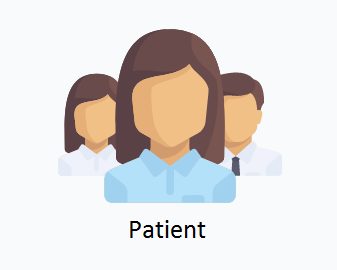

# Idha

A disease prediction web app. You punch in your symptoms, it tells you what you probably have and which kind of doctor to see. Then you can actually book a consultation with a doctor on the platform and chat with them.

Built with Django and scikit-learn. The ML model was trained on [this Kaggle dataset](https://www.kaggle.com/neelima98/disease-prediction-using-machine-learning) — it covers 42 diseases and around 130 symptoms.

## What it does

- **Symptom checker** — pick your symptoms from a list, get a prediction with a confidence score
- **Doctor matching** — maps the predicted disease to the right specialist (cardiologist, dermatologist, gastroenterologist, etc.)
- **Patient & doctor accounts** — separate registration and profiles for each
- **Consultations** — patients can request a consultation with a doctor, track status
- **Chat** — real-time-ish messaging between patient and doctor during a consultation
- **Ratings & reviews** — patients can rate doctors after a consultation
- **Admin panel** — feedback overview and management

## Screenshots





## Setup

You'll need Python 3, PostgreSQL, and pgAdmin (or any way to create a Postgres database).

**1. Create the database**

Make a PostgreSQL database called `predico`. Easiest way is through pgAdmin.

**2. Install dependencies**

```bash
pip install -r requirements.txt
```

This pulls in Django 3.0.3, scikit-learn 0.21.3, joblib, and psycopg2.

**3. Run migrations**

```bash
python manage.py makemigrations
python manage.py migrate
```

**4. Start the server**

```bash
python manage.py runserver
```

Go to http://127.0.0.1:8000/

## Project structure

```
├── main_app/          # core app — disease prediction, consultations, chat, doctor matching
│   ├── models.py      # patient, doctor, diseaseinfo, consultation, rating_review
│   ├── views.py       # symptom checker logic, consultation flow, chat endpoints
│   └── loadmodel.py   # quick script to verify the trained model loads
├── accounts/          # signup/login for patients and doctors
├── chats/             # chat and feedback models
├── disease_prediction/# django project settings, root URL config
├── templates/         # HTML templates (homepage, signin, consultation, etc.)
├── trained_model      # pre-trained scikit-learn model (joblib serialized)
├── pics/              # screenshots
└── requirements.txt
```

## How the prediction works

The trained model is a classifier loaded via joblib at server startup. When a patient submits symptoms:

1. A binary vector is built — 1 for each symptom present, 0 otherwise (132 features)
2. The model runs `predict()` to get the disease name
3. `predict_proba()` gives the confidence score
4. The predicted disease is mapped to a doctor specialization through a hardcoded lookup
5. Everything gets saved to the database so the patient can then consult a matching doctor

Nothing fancy, but it works.

## Tech stack

- Django 3.0.3
- scikit-learn 0.21.3
- PostgreSQL + psycopg2
- jQuery (for async symptom submission and chat polling)
- joblib (model serialization)

## License

Apache 2.0 — see [LICENSE](LICENSE).
